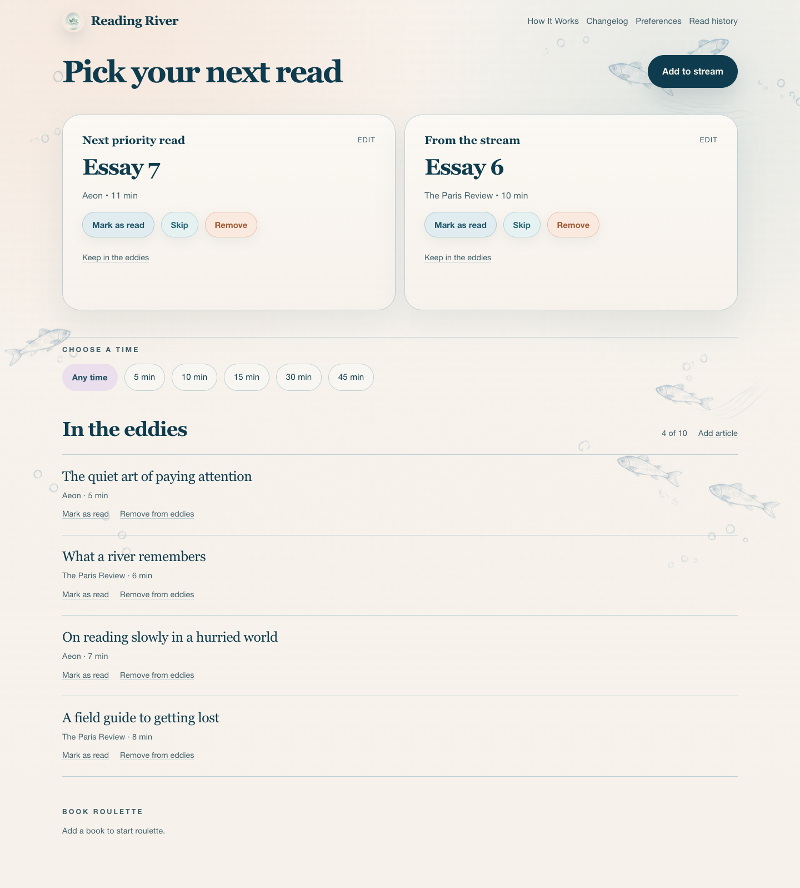
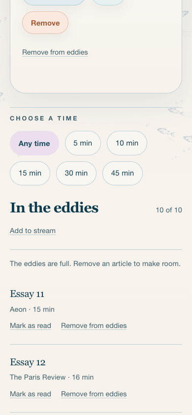

# In the eddies — implementation and verification

A private, manually curated selection of up to ten existing Reading River articles. Additions never rotate or expire. The homepage presents an editorial list between the time picker and Book Roulette, ordered newest first.

## Database guarantee

`ReadingItem` gains nullable `eddySlot` and `eddyAddedAt` fields. Migration `20261019120000_reading_river_eddies` adds:

- A unique index on `(userId, eddySlot)`.
- A CHECK restricting occupied slots to integers 1–10.
- A CHECK requiring the slot and timestamp to be either both null or both present.
- A CHECK allowing membership only for active article types and statuses.

For each user there are exactly ten possible non-null slot values, and each value can occur once. This makes an eleventh membership impossible even for writers bypassing application code. Ordinary articles retain null slots and are unrestricted by the unique index. No backfill is necessary.

Allocation uses an interactive READ COMMITTED transaction. It takes a `FOR NO KEY UPDATE` lock on the authenticated user's row before writing an article, serializing competing allocations for that user without blocking foreign-key key-share checks. After acquiring a `FOR UPDATE` lock on the owned article, it checks eligibility and current membership, reads at most ten occupied slots, and assigns the first available slot. Repeated adds preserve the slot and timestamp, including at capacity. Other users allocate independently. Article locking coordinates with concurrent completion/deletion; its stronger lock avoids an upgrade deadlock with ReadEvent foreign-key checks. All locks release on commit or rollback.

Selected URL intake checks duplicates, creates the original article and tags, and allocates membership in the same transaction. Full capacity rolls all of this back. Concurrent identical selected URLs are checked after the user lock and cannot create duplicate articles. Ownership always comes from authentication; the intake action no longer accepts a user-id override.

Relevant database semantics: [PostgreSQL constraints](https://www.postgresql.org/docs/current/ddl-constraints.html) and [Prisma interactive transactions](https://www.prisma.io/docs/orm/v6/prisma-client/queries/transactions).

## Entry, removal and performance

- Recommendations expose Keep in the eddies; existing members expose Remove from eddies.
- URL intake has an Add to the eddies checkbox, preserved through review and capacity errors. Section intake links preselect it. Full sections link to ordinary intake instead.
- Article editing exposes immediate add/remove actions independently of saving metadata.
- Removal clears membership without deleting the article. Mark as read uses the existing ReadEvent/history transaction and clears membership. Status changes to done/not_now/archived and edits changing the source to manual/book_chapter also clear membership. Deletion releases the slot with the row.
- A single narrow homepage query fetches at most ten memberships. The existing Prisma pool and client-side time-filter architecture remain in use. Recommendations prefer articles outside the eddies, falling back to the existing suitable candidate pool when necessary. No extra dependencies were added.
- Server actions revalidate homepage and edit views; marking read also revalidates history. Controls disable while pending and announce results/errors without optimistic success. Rows use native buttons/links, wrapping actions, visible focus and 44px touch targets.

## Files changed

Storage and operations:

- `prisma/schema.prisma`
- `prisma/migrations/20261019120000_reading_river_eddies/migration.sql`
- `lib/reading-river/eddies.ts`
- `lib/reading-river/eddy-state.ts`
- `lib/reading-river/source-url.ts` (narrow client type supporting transactions)
- `app/reading-river/actions/eddies.ts`
- `app/reading-river/actions/ingest-url.ts`
- `app/reading-river/actions/reading-items.ts`

Homepage and forms:

- `app/reading-river/page.tsx`
- `lib/reading-river/homepage-data.ts`
- `components/reading-river/eddies-section.tsx`
- `components/reading-river/eddy-article-actions.tsx`
- `components/reading-river/home-read-card.tsx`
- `components/reading-river/url-intake-form.tsx`
- `lib/reading-river/intake-form-state.ts`
- `app/reading-river/add/page.tsx`
- `app/reading-river/items/[id]/edit/page.tsx`
- `app/reading-river/reading-river.css`

Regression tests:

- `tests/integration/reading-river-eddies.test.ts`
- `tests/components/reading-river-eddies.test.tsx`
- `tests/actions/url-intake-action.test.ts`
- `tests/actions/url-intake-jsdom-runtime.test.ts`
- `tests/lib/reading-river-homepage-data.test.ts`
- `tests/ui/add-item-flows.test.tsx`
- `tests/ui/reading-river-edit-item-page.test.tsx`
- `tests/ui/reading-river-home-page.test.tsx`

Review artifacts: this report, `browser-results.json`, `desktop.png`, `mobile.png`, `mobile-empty.png`, and `mobile-full.png`.

## Verification

All migrations were applied successfully to a disposable PostgreSQL 16 container, bound only to localhost. No production migration was applied.

- 20 PostgreSQL integration cases cover first/tenth/eleventh additions, twelve contenders for the final slot, concurrent repeat adds, release/reuse, read history, concurrent read/add, all inactive statuses, type changes, deletion, excluded types, ownership, inline edit-action capacity errors, atomic URL intake/tag rollback, concurrent duplicate intake, authenticated intake ownership, review retry, newest-first ordering and direct constraint violations.
- Feature-related Vitest suite: 158 tests passed across 26 files.
- Entire Vitest suite: 315 passed, five failed across three unrelated files. Those same five failures reproduce on untouched `origin/main`: two navbar accessibility expectations, two project-page content expectations, and one blog-update blockquote expectation.
- `npx tsc --noEmit --incremental false`: 21 existing diagnostics. Twenty reproduce from an untouched main checkout; the additional diagnostic is a stale `.next/dev/types` layout-export check against the existing `EditorialShell` export. No new feature diagnostics. The production build's TypeScript stage passes.
- `npm run build`: passed with the isolated database configured.
- Mutation check: inverting the capacity guard causes the first-add regression to fail; source restored and feature suite rerun successfully.
- Real Chrome browser checks at 1440px desktop and 390px mobile: no page errors, no horizontal overflow, readable titles, 44px actions, 2px visible keyboard focus, add/remove/edit revalidation, history creation, preselected intake, inline full-capacity error, and empty/full states. Filter selection makes no homepage/document request; existing spotlight edit-link prefetches can still occur. See `browser-results.json` for observations.

Screenshots use synthetic local articles. Desktop shows the entire homepage; mobile captures the section, plus empty/full variants.






## Repeating the PostgreSQL tests

Start an isolated PostgreSQL instance with a database named `eddies_test`, then set `DATABASE_URL` and `EDDIES_TEST_DATABASE_URL` to its localhost connection string. Set `DATABASE_SSL_NO_VERIFY=0` if local environment files enable SSL overrides.

```sh
npx prisma migrate deploy
npm test -- tests/integration/reading-river-eddies.test.ts
```

The integration suite refuses remote URLs and databases other than localhost `eddies_test`, creates unique test users, and removes only those users afterward. It is skipped when `EDDIES_TEST_DATABASE_URL` is absent. Never point this workflow at production.

## Remaining limits

The migration must be applied through the normal release process before running this feature against an existing database. This change does not merge or deploy anything. Browser verification used installed Chrome, not a screen reader or every browser engine. The host Node runtime was 26.8.1; the repository's deployment target remains Node 22. Existing repository-wide test/type errors are documented above. Basecamp project context could not be read because the CLI reported no authenticated account.
