# Reading River: drifting by

A working prototype on `codex/reading-river-eddies`. It is uncommitted and not deployed. Screenshots use synthetic local data from `scripts/seed-drift-demo.ts`.

The fixed "Next priority read" / "From the stream" pair is replaced by a river running through a sunlit glade, painted in oils. A slow stream of pieces rides the current on little rafts. You are a small figure on the bank: walk over to a raft to see what it carries.

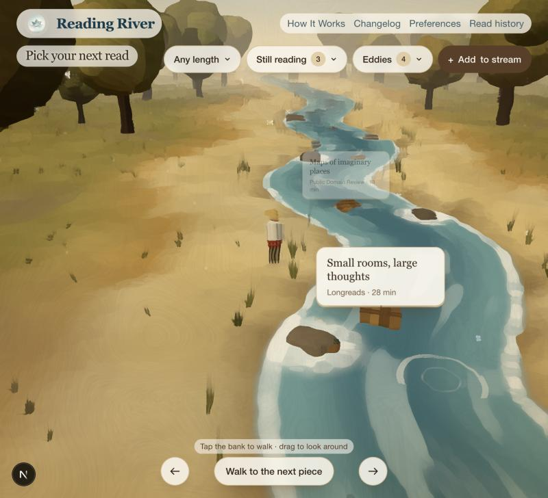

## Round seven: Monet's bridge, paper labels, and things you bump into

- **The bridge** now follows Monet's Japanese footbridge at Giverny: a high, round arch painted green, a boarded deck, a top rail and a middle rail, and a lattice of slender balusters on each side.
  - You can only get on at the ends. Tapping the bridge walks you round to the nearer end and up, and leaving takes you off the end on the side you're heading for. From the side you stay below, and can wade underneath the arch. The deck height now changes smoothly from the bank, with no jump.
- **Water lilies, as in his pond.** About 300 pads lie in drifts round the eddy pool and all about the water by the bridge, with pink, white and yellow flowers. Violet irises grow on the banks by the bridge. The middle of the river stays open for the rafts.
- **The eddies sit back from the river** across a strip of bank, joined to it by a narrow inlet. A piece that drifts out crosses the pool, goes down the inlet and away downstream.
  - Standing at the pool, only the pool's pieces show; the river's cards wait until you step back toward the water.
  - The pool's column of cards stands beside the pool, not over it, and below the top chips.
- **Cards are paper labels tied to the rafts:**
  - torn, deckled edges;
  - sun-faded paper with a painted wash and grain;
  - a punched hole and a twist of twine down to the boat;
  - an italic title, small-caps details and a brushed stroke between them.

  Each label hangs at its own slight angle and straightens as you reach for it. Pool labels are washed with the pool's green-blue, and the lifted actions open on a larger sheet of the same paper.
- **Things you bump into.** Trees, willows, rocks, the fallen log, the heron, ducks and rabbits are solid. The walker edges round them toward where you were going, and stops if the spot itself is taken. Ducks paddle out of your way, a rabbit bolts if you come close, and the kingfisher leaves its perch early.
- **Tiny name labels for the larger things you stand near:**
  - heron, mallards and gulls;
  - water lilies, irises, bulrushes and the willows;
  - the fallen log, the footbridge and the barge.

  Each label is just the name, in small italic on a faint pill. Small, quick creatures (bees, butterflies, the kingfisher and so on) go unlabelled. A label never sits on top of an article card: it moves below the thing, or waits.
- **Trees** are smaller and slimmer, and set back further. Any trunk or crown near the camera, or between the camera and you, dissolves so it doesn't block the view.

| Monet's bridge | Paper labels and lilies | A name label |
| --- | --- | --- |
| 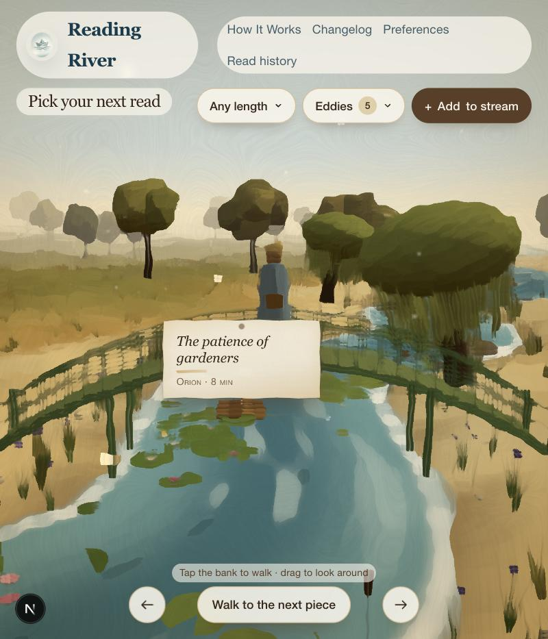 | 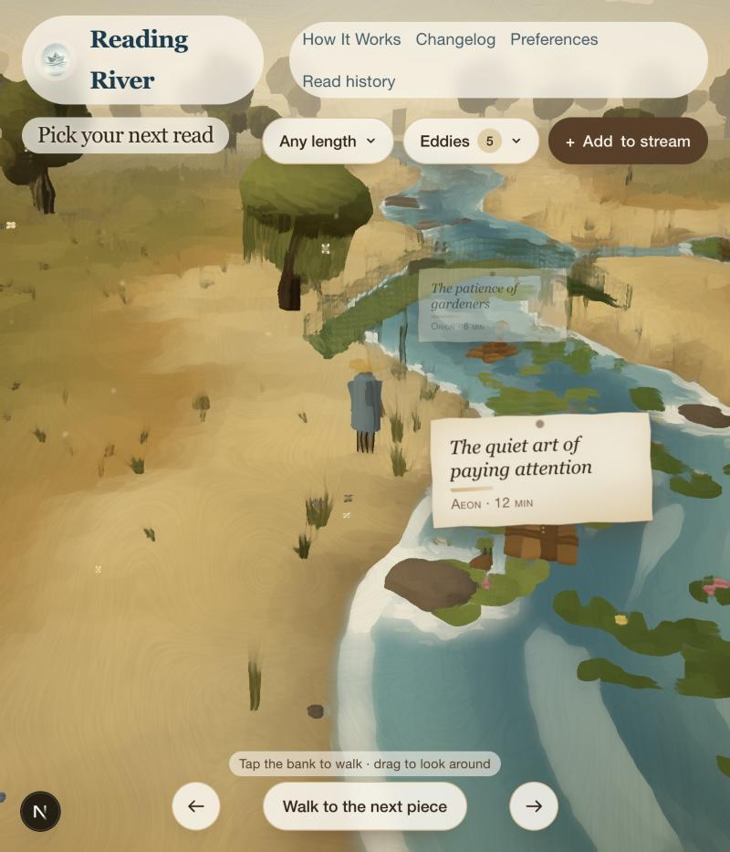 | 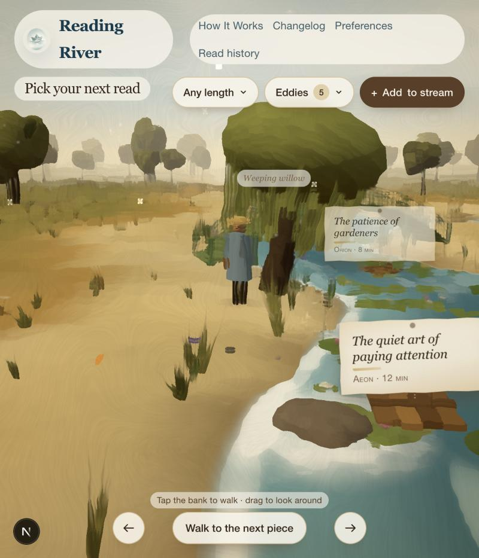 |

## Round six: the eddy pool, a bridge and more of the river bank

- **The eddies are a place now.** A round pool opens off the river beside the glade. Its water turns slowly, with foam round the rim, lily pads, pond skaters and two fish.
  - **Starting to read a piece carries it into the pool.** The raft leaves the stream and turns in the eddy, and the Eddies chip counts it.
  - The pool holds five. When a sixth arrives, the one that has been there longest drifts out through the mouth and away downstream, and it goes back to being an ordinary unread piece that can come round again. The page says which one went.
  - Near the pool, its pieces stand in a tidy column above it, one compact line each, so they never pile up. Lift one for **Carry on reading**, **Mark as read**, **Let it drift back into the river** or **Edit**; the rest step back while you do.
  - The Eddies chip opens **In the eddies** (5 at most), **Drifted past** and, only if there are any, **Still reading**. Still reading is for pieces opened before this change that aren't in the pool.
  - On the server, `EDDY_CAPACITY` is 5 and adding to a full pool lets the oldest go rather than refusing. Migration `20261105120000_reading_river_eddy_pool` keeps each reader's five newest and lets the rest drift back. It has been tried on local data only.
- **No more "Not now".** Leaving a piece be is enough: it drifts on by itself. "Keep in the eddies" and "Renew priority" are gone from the river card too; reading is how things reach the eddies now.
- **A footbridge** crosses the river near the middle of the glade: an arched plank deck with posts and handrails. Walk over it, or wade.
- **The walker** wears a loose knee-length smock in faded blue, dark trousers, a round straw hat and a satchel for books. There is nothing gendered about the figure.
- **More of the river bank:**
  - lily pads with white flowers;
  - bulrushes in the shallows;
  - drifts of wildflowers (buttercups, daisies, cornflowers, a few poppies);
  - pebbles at the water's edge;
  - two weeping willows leaning over the water;
  - a fallen log with mushrooms by the pool.

  New creatures:
  - a kingfisher that streaks low along the river, perches, then dives;
  - an otter that swims across, dives and surfaces again;
  - a frog that sits out on a lily pad before plopping off;
  - midges dancing over the water;
  - bees working the flowers;
  - thistledown lifted by strong gusts.
- **Trees keep out of the way.** They are smaller and slimmer and set further back from the river. Any trunk or crown close to the camera, or between the camera and you, dissolves so you can always see yourself.

| Bridge, willow and pool | The eddies, close to |
| --- | --- |
| 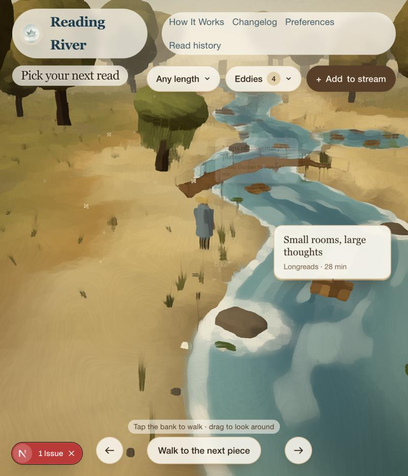 | 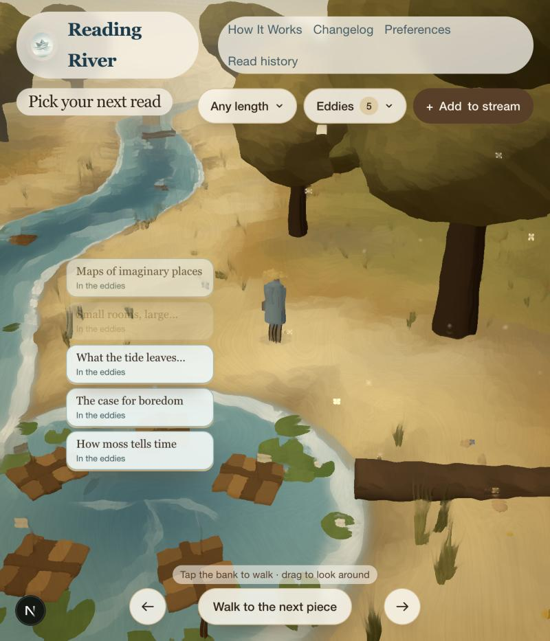 |

## Round five: you, and the life of the glade

- **You are the walker.** A small figure in the haulers' clothes stands on the bank: a pale shirt, a red sash and a straw hat.
  - Tap the bank, or the water, to walk there. You can wade across, which leaves ripples. The view follows you, and dragging still turns all the way round.
  - **Pieces only open up when you are near them**, within about 10 units, and fade as you walk off. From further away a piece is just a raft with a cream pennant.
  - **Walk to the next piece** goes to the bank beside the nearest raft you can't read yet, and says where you're going. This is the keyboard and screen-reader route too.
  - The walker stays within 90 units of the glade.
- **Seen means you went to look.** A piece counts as seen only once it has been open near you, on screen, for 4 seconds. Rafts you never walked to add nothing.
- **Life in the glade** (`components/reading-river/glade-life.ts`). Some creatures are always about, near wherever you are:
  - kites high up and pale gulls over the water;
  - a heron in the shallows that now and then dips to fish;
  - two ducks paddling upstream, leaving wakes;
  - fish holding under the surface as dark shapes, with the odd dart;
  - dragonflies hopping about the reeds;
  - three butterflies over the grass.

  Others happen now and then, each on its own unhurried timer:

  | Event | Roughly every |
  | --- | --- |
  | Frog plop at the bank's edge | 10–22 s |
  | Fish jumping, with spray and ripples | 14–30 s |
  | A leaf falling from a tree, floating off if it lands in the river | 12–26 s |
  | A pair of swallows skimming the river | 30–65 s |
  | A gust that bends the grass and trees and often shakes a leaf loose | 35–75 s |
  | A rabbit hopping out, pausing to look about, then off | 1–2 min |
  | A starling flock crossing the sky | 1½–2½ min |

  Cloud shadows drift slowly over the land and water. Birds that only visit are made once and reused, so nothing piles up. A test simulates an hour of glade life to check this.
- **No more Priority tag.** Priority now only nudges: at most 3× as likely to join the stream, down from 5×. Nothing on the page marks a piece as a priority. How It Works says so.
- **Reduced motion:** the creatures are placed once and hold still. Walking happens instantly, without the walk.

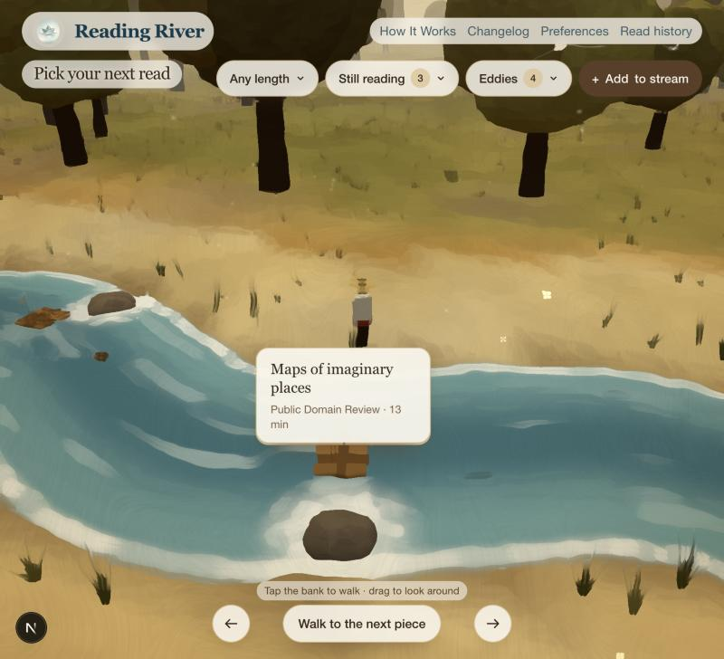

## Round four: a moving oil painting

- **Painted look.** The 3D scene is drawn into a texture and then repainted:
  - a Kuwahara filter flattens colour into broad daubs;
  - a slow wobble breaks up edges like a loaded brush;
  - directional stroke texture, canvas weave and grain;
  - a warm varnish grade and an umber vignette.

  Trees, grass, rocks and ground carry a dappled light-and-dark that the filter turns into brushwork. Trees and grass sway in the wind. The trees are smooth, lumpy masses now, with soft shadows under them.
- **Two Repin water paintings.**
  - *Barge Haulers on the Volga* still sets the land and sky: haze, sand-gold, ochre, umber, and the red flag on the barge.
  - *What Freedom!* sets the water: wind-driven blue-green, white foam breaking round rocks in the stream, foam lapping at both banks, scattered whitecaps and choppier waves.
- **Turn all the way round.**
  - Drag anywhere on the glade to orbit the river, with a little inertia. Up and down tilts the view; the scroll wheel steps closer.
  - The arrow buttons turn 45° at a time, and **Face the river** goes back to the start.
  - The river, banks, trees and hills continue in every direction, so you can watch pieces arrive from upstream and leave downstream.
  - Tapping the water, as opposed to dragging, still sends out ripples.
- **A continuous stream.**
  - Each day's draw is now up to 16 pieces (`DRIFT_RULES.streamLength`), not 3. They follow each other down the river about 17 units apart at about a fifth of a unit a second, so a piece takes a few minutes to pass and you see three or four at once.
  - Past the end of a stretch of river centred on the glade, pieces wrap round out of sight and come back upstream. A small collection simply keeps circulating.
  - A piece you hover, focus or lift waits where it is. Opening one moves it to Still reading straight away, and its replacement joins upstream.
  - "Let them drift on" is gone. Time now does the stirring.
- **Exposure is counted per piece.** A piece counts as seen once it has been in view, unfaded and on screen, for 4 seconds in a visible tab, at most once a day. Pieces that drift past unseen, or that sit behind you, add nothing. Settling, snoozing and priority work as before.
- **Drifted past** now includes pieces from today's stream that you saw and that have since floated on, leaving out any that are still in view.
- **Fallbacks.**
  - With reduced motion, the stream and wind hold still. Turning still works, and it snaps rather than easing.
  - Without WebGL 2, three pieces sit down the middle of a painted gradient.

| Turned downstream | Lifted | Phone |
| --- | --- | --- |
| 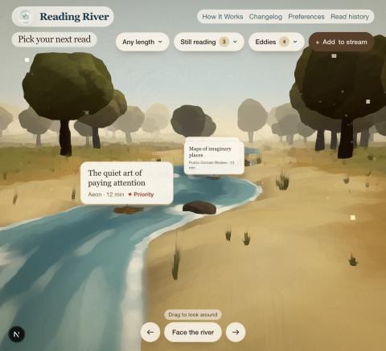 | 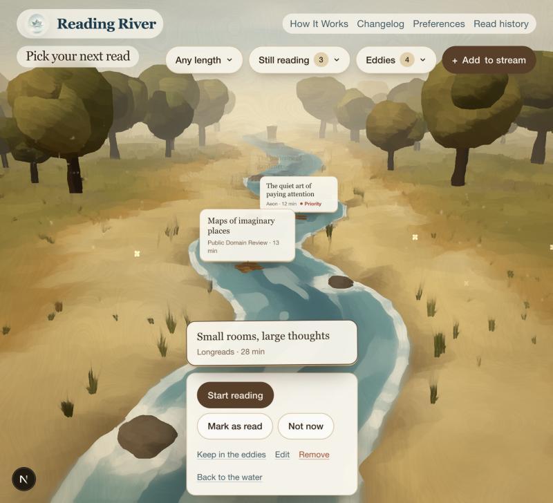 | 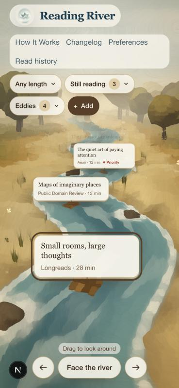 |

## Round three: the glade (superseded look)

- **Real 3D.** `components/reading-river/glade-engine.ts` builds the scene with three.js; it is the only new dependency.
  - The river winds from the far haze toward the viewer, with water that flows, glints and shows the sand in its shallows.
  - Sandy banks give way to ochre and olive grass, low-poly trees ring the clearing, and blue-grey hills sit on the horizon.
  - A barge with a red flag sits far upstream, birds wheel overhead and dust drifts in the sun.
  - The camera follows the pointer slightly, and touching the water sends out ripples.
- **Volga palette.** The colours come from Repin's *Barge Haulers on the Volga*:
  - a hazy pale-blue sky;
  - sand-gold, ochre and umber;
  - silver-grey water;
  - one red, used for the flag and the Priority mark.
- **The pieces are still HTML.** Each card is a real button. Every frame, the engine projects its raft onto the screen and moves the card there, so keyboard use, screen readers and text sizing all work as before. Rafts are spaced evenly through the open water between the top chips and the drift-on button, whatever the window's shape.
- **Only the river and three pieces show.** Everything else is a dropdown chip along the top:
  - **Time** (Any length / 5–45 min);
  - **Still reading** (with Drifted past a tab away);
  - **Eddies**;
  - **Add to stream** is a plain link.

  Menus close on Escape or a click elsewhere. On phones they open as sheets from the bottom.
- **Choosing a piece** stops its drift and opens its actions right under it: Start reading, Mark as read, Not now, Keep in the eddies, Renew priority, Edit, Remove, Back to the water. A ripple spreads out from its raft.
- **Drifting on** speeds up the current. The three pieces sweep past the viewer and fade, and new ones come in from upstream.
- **Book Roulette is off the home page.** The page no longer loads home-page data for it. Book Roulette still appears in reminder emails (an option in Preferences), and books are still managed on the Books page.
- **Fallbacks.**
  - With reduced motion, the glade is a still frame: no drift, flow, birds or parallax, and changes happen instantly.
  - Without WebGL, the cards sit down the middle of a painted gradient.
  - three.js loads in the browser only after the page is up.

| Lifted | Still reading | Phone |
| --- | --- | --- |
| 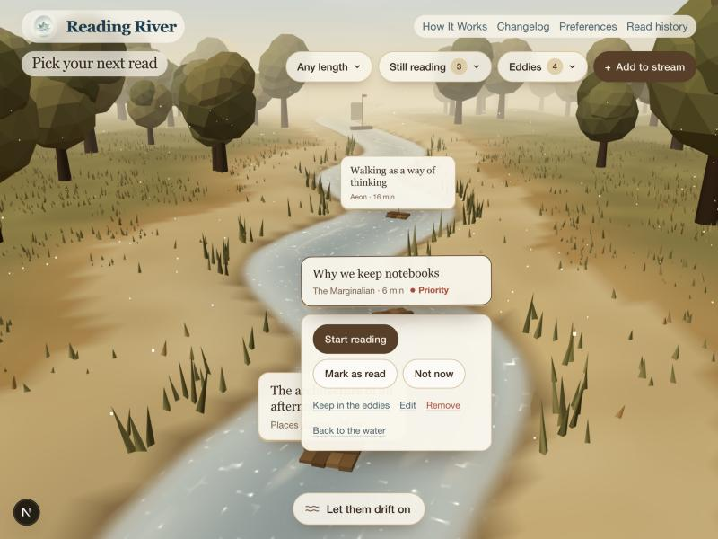 | 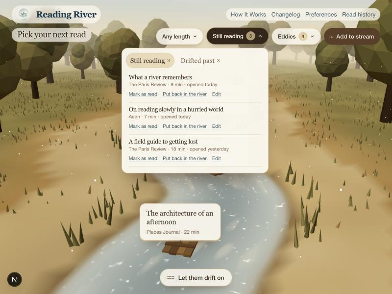 | 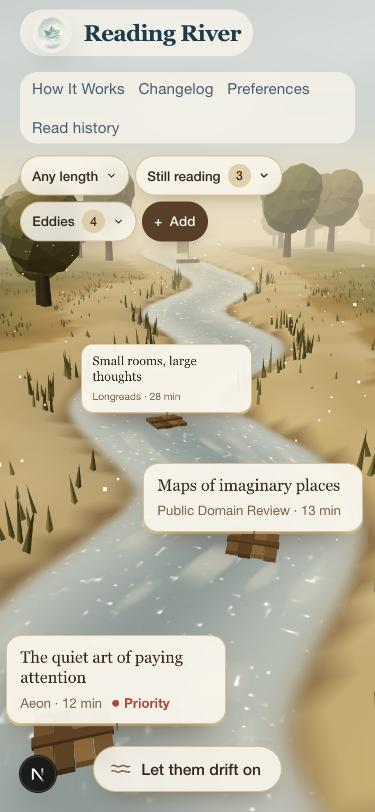 |

## Round two: one still painting (superseded)

- **No page scroll** on screens 760×528 and larger. The painting covers the whole window, and everything sits on it:
  - the title, time choice and Add to stream along the top;
  - the eddies on their own side pool;
  - a bank row along the bottom: Still reading (with Drifted past a tab away), the chosen piece with its actions, and Book Roulette.

  Long lists scroll inside their panel, never the page. Phones still get a stacked layout that scrolls, with the river running down the screen.
- **The painting.**
  - Raked gravel and stones with rake rings.
  - Watercolour-edged banks and moss, reeds, a maple branch, and a paper-grain wash.
  - A river that enters on the left and leaves at the bottom right.
  - A side pool for the eddies, with slow swirls and three koi.
  - Maple leaves riding the current.
- **Reduced motion.** The swirls, koi, leaves and current only move when the reader hasn't asked for reduced motion.
- **Pieces stay on the water at any window size.** They are placed in JavaScript, spaced evenly across the open water left of the eddies, each at the river's height at that point.
- **Opening moves a piece to Still reading at once.** Articles open in a new tab so the river stays put. The piece appears under Still reading immediately, and the server refills its place on the water a moment later.

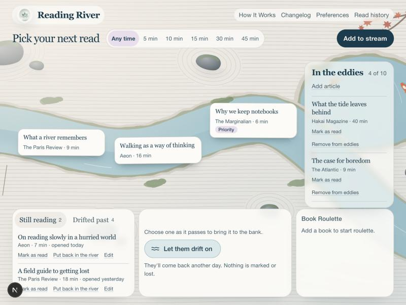

## Round one

## The interaction

- **Three afloat, steady for the day.** Reloads and revisits show the same three. Any that are read, removed, kept in the eddies or opened are replaced one at a time, and the others stay put.
- **Choose one → the bank.** The floating card is a button. Choosing it pauses the drift and opens a panel under the river with every existing action: Start reading, Mark as read, Not now, Keep in the eddies, Renew priority, Edit, Remove. "Back to the water" closes the panel.
- **Let them drift on** sends all three downstream, about 1.3 seconds out, and three new ones come in from upstream over about 2.3 seconds. The current speeds up briefly. The three that left rest for 20 hours. Nothing is marked, deleted or reprioritised.
- **Not now** does the same for a single piece.
- **Choose a time** filters to pieces that fit. Every time budget is drawn on the server ahead of time, so switching between them is instant.

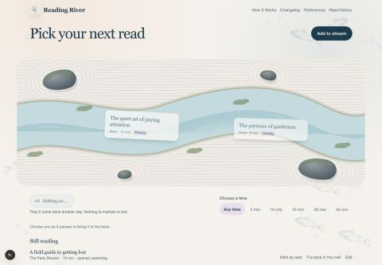

## Reading across two days

Opening a piece's link records it (`fetch` with `keepalive`, so the note survives leaving the page) and lifts it onto the bank. Its status becomes `reading`, an existing status, and it leaves the water. It then sits under **Still reading** until you mark it read or **put it back in the river**, whatever the river shows that day. Coming back with the browser's Back button refreshes the page, so the piece is already on the bank.

If you read something without opening it from here, **Drifted past this week** (a collapsed list) shows the last week's passers, and you can mark one read from there.

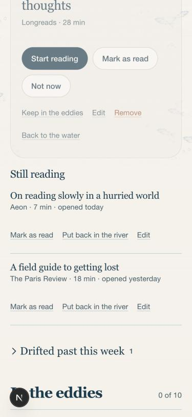

## How the rules fit together

The rules live in `lib/reading-river/drift.ts` as one `DRIFT_RULES` object, so the values below can be tuned in one place.

**Weight** = priority factor × recency factor, and it is always above zero.

- Priority factor: 1 + 0.4 × priority, so priority 10 is 5× as likely as none. Priority counts for 14 days from when it was set, renewed or changed in Edit. After that it is 0 (ordinary chance) until you renew it. Pieces without a renewal date count from when they were added.
- Recency factor: 0.25 if the piece was seen today, recovering by 0.15 a day back to 1.

**The draw** is weighted sampling without replacement. Pieces are taken from tiers in order:

1. Fresh pieces.
2. Pieces resting after drifting on.
3. The pieces that just left, only when the collection is too small for anything else.

Snoozed pieces never surface. There are no roles, quotas or variety rules, so three similar pieces can appear together.

**Exposure.** A piece counts as *seen* only after it has stayed afloat for 4 seconds in a visible tab. When you first visit on a later day, that earlier day's selection is settled. Each seen, unopened piece that was still afloat at the end of that day gets one unread appearance, at most once per day across all time budgets. This means:

- reloads add nothing;
- days you never visited add nothing (nothing was drawn or seen);
- drifting on adds nothing, because the pieces that left are removed from that day's selection before it settles.

**Snoozing.** Two unread appearances snooze a piece for 3 days. One more after it returns snoozes it for a week, and so does each further one. Opening a piece, or renewing its priority, clears this history. If everything is snoozed, the river says when the first piece returns and offers **Bring them back now**.

## Small and empty collections

- **One or two pieces:** they sit centrally, "Let them drift on" is disabled, and the hint says "That's everything within reach for now".
- **Everything resting:** says when the first piece returns and offers to bring them all back.
- **No piece fits the chosen time:** offers "Show any length".
- **No pieces at all:** "The water is clear" with Add to stream.

| Small | All resting | Empty |
| --- | --- | --- |
| 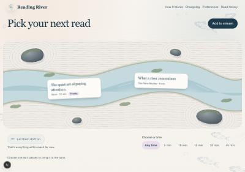 | 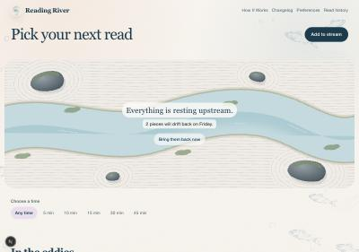 | 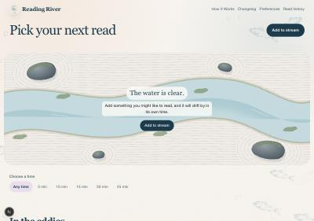 |

## Visual choices

- **A Japanese garden, not a literal pond.** The garden is an inline SVG (`components/reading-river/garden-scene.tsx`) with raked gravel lines, cleared rings around four stones, moss on the stones and banks, and a meandering river with a blurred deeper channel. Faint current lines move along it and a few petals float past.
- **The app's own palette.** Warm paper, deep river ink and the lilac accent are kept, with sage moss and pale teal water added.
- **Restrained motion.** Pieces wander very slowly (36–50 second cycles) and bob a few pixels. They stop whenever the pointer or focus is in the garden, and whenever a piece is on the bank, so you can read and settle.
- **App-wide.** Quieter page light and softer section labels (sentence case, no tracked capitals). The primary button has no shadow and there is more vertical space.
- **Mobile.** The garden turns so the river runs top to bottom. Pieces flow downward and nothing scrolls sideways at 375px.
- **Accessibility.**
  - Floating pieces are real buttons with `aria-pressed`. Choosing one moves focus to the bank, which is labelled with the piece's title.
  - Changes are announced in a live region.
  - Focus rings are visible, and all targets are at least 44px.
  - Text contrast is about 11:1 for ink on paper, and the primary button is the same.
  - With `prefers-reduced-motion`, the current, petals and wandering stop, and drifting on becomes a short fade.

## State added (migration `20261104120000_reading_river_drift`)

On `ReadingItem`:

- `priorityAssignedAt`: backfilled to release time so existing priorities aren't expired at once.
- `lastSurfacedAt`
- `driftMisses`
- `snoozeLevel`
- `snoozedUntil`
- `restingUntil`

New table `DriftState`: one row per user, holding the current selection per time budget (`ids`, `drawnOn`, `seenIds`).

Reused as they were: `status = reading` and `lastOpenedAt`.

## Changed behaviour

- **Skip is gone from the home page.** It set priority to 0, which conflicts with "never remove priority". Not now / Let them drift on replace it. `skipReadingItem` still exists.
- **Eddy articles never float.** The eddies are a curated list already on the same page.
- **Changing priority in Edit renews its 14 days.** Saving the form with the same priority does not.
- **Days use UTC**, as the existing daily picks did.

## Verification

- `tests/lib/reading-river-drift.test.ts`: 11 tests for weights, expiry, the draw, repeat avoidance, small collections and snoozing.
- `tests/integration/reading-river-drift.test.ts`: 6 tests against a local PostgreSQL. They cover:
  - steadiness within a day;
  - an opened piece staying on the bank the next day;
  - recently passed pieces;
  - reloads and unvisited days not counting;
  - drifting on never counting and avoiding repeats;
  - the "nothing else upstream" state.

  Run them with `DRIFT_TEST_DATABASE_URL` pointing at a local database. The suite refuses remote hosts.
- Home page and How It Works tests have been updated. The full suite has 306 passing, plus 5 failing navbar, projects and blog tests that already failed before this work.
- Checked in a browser at 1440px and 375px:
  - lift, drift on, open → Still reading;
  - the small, all-resting and empty states;
  - keyboard: Enter lifts, focus moves to the bank, Tab continues into its actions.
- **Not checked visually:** reduced motion (the browser tool can't emulate it), screen readers, Safari.

## Round 8: quieter controls, depth, and The Hay Wain

- The Any length and Eddies chips are gone; the pool shows the eddies. How It Works, Changelog, Preferences and Read history fold into the river mark in the top-right corner, on a faint frosted backing. Other pages keep their row of links.
- Arrow keys (or WASD) walk you about, relative to the camera; on the bridge the rails keep you on the deck.
- "Walk to the next piece" goes round every piece afloat in the order they came down the river, then starts again.
- Cards have depth: far ones are smaller, hazier and lean back with the water; near ones are large and clear; each bobs and rocks a little.
- The hint and the walk/turn buttons along the bottom are nearly transparent.
- Name labels are small and quiet but readable, and there's one per patch of lilies, irises or rushes rather than one per plant.
- After Constable's The Hay Wain: a wain with a bay and a grey standing in the ford downstream (ripples round the wheels, heads nodding), a cottage with smoke from its chimney on the far bank, heaped cumulus with grey bellies on a deeper blue, and deeper English greens among the trees.

## Round 9: quick add, no priority

- "Pick your next read" loses its backing and sits on the painting with a soft glow, like the controls at the bottom.
- Add is a quiet chip that opens a small dropdown: paste a link and we fetch the title and reading time and save it straight away (`quickAddUrl` in `app/reading-river/actions/ingest-url.ts`). Only when the page won't say how long it is does it ask for the minutes. "More ways to add" still goes to the full page (books, tags, notes).
- Priority is gone: no field when adding or editing, new pieces save with none, saving an edit clears any left over, and the river's draw gives every piece the same chance (only having just drifted past lowers it). The database column stays for now.

## Round 10: lifting a piece

- A lifted label opens into one larger sheet of the same paper, rather than a separate panel of big buttons.
- Tap the title or the reading time to change it in place. Enter saves, Escape cancels. Edit and "Back to the water" are gone.
- On the river: **Start reading** opens the source in a new tab and carries the raft into the eddies. The raft is seen travelling along the river, up the inlet, and into the pool.
- In the eddies: **Continue** and **Finished**. Finished marks the piece read. The label glows gold, the raft grows into a little ship with a sail and a gold pennant, and it sails out through the inlet and away downstream.
- **Remove** asks "Are you sure?". Then the raft floats away downstream, or out of the eddies, and the piece is deleted.
- "Pick your next read" uses the same lettering as Add and the controls at the bottom.

## Round 11: clouds

- Afloat, a piece is just its title in Spectral italic (chosen from seven faces tried live) on a small soft cloud. The cloud is cream on the river and blue-green in the eddies, and turns gold when finished. The paper tag, the pin and the twine are gone.
- Titles are bigger (1.36rem) and stop after three lines with an ellipsis. The whole title shows on hover and when you lift the piece.
- Add is a "+" circle, pinned at the same height as the menu button beside it.
- The menu links use the same lettering and ink as "Pick your next read".

## Round 12: four more river paintings

- **Thomas Cole, The Oxbow.** Upstream, on the far side from the eddies, a horseshoe of still water where the river once looped and later cut through. Its horns point back at the river. A storm-broken tree with a last scrap of autumn leaves stands on the rise beyond. The ground, trees and reeds treat it as water, so it sits in a clearing with reeds round its edge.
- **Seurat, La Grande Jatte.** Seven parasols are planted at a slant in the grass downstream of the glade. Each canopy is painted in dots of its colour and that colour's complement, and each casts a soft shadow.
- **Turner, The Fighting Temeraire.** A hobbyist's model of the ship, ghost-pale, with three masts, crossed yards and sails furled. A little black paddle tug tows it downstream on a sagging line, trailing smoke with orange sparks. It loops along the river from far upstream to well past the glade, and starts partway so it passes soon after you arrive.
- **Waterhouse, The Lady of Shalott.** Just her boat, moored by a chain to a stake in the reeds. It has an open wooden hull, and her red-and-gold tapestry spread inside, over the side and out on the water. At the prow are three candles, two gone out and one still flickering with a glow, plus a lantern on a post and a small brass cross.
- Each has a label when you're near: "An oxbow lake", "Parasols", "A model of the Temeraire, under tow" (it follows the model) and "The Lady of Shalott's boat".

## Round 13: no labels, and the river makes the oxbow

- No more labels. Animals, plants, the bridge, the barge and the painting references are all left to be noticed or guessed. The label system is removed entirely.
- **The river itself is Cole's oxbow now.** Upstream, on the far side from the eddies, it swings out round a near-closed loop and comes back to a narrow neck of land, as in the painting. The loop wraps a peninsula of patchwork fields (wheat, stubble, pasture) with no trees on it. The separate lake is gone. Cole's storm-broken tree stands on the near bank below the loop. Rafts drifting from far upstream come round the loop, and so does the Temeraire.
- Places along the river given by distance down the valley skip the loop, so the rocks, the barge and so on stay on the main channel.
- **More spread out.** The Lady of Shalott's boat moved upstream below the oxbow, about 35 paces from the heron. The Temeraire starts just below the footbridge, heading off past the parasols. After a long loop it comes back from far upstream, through the oxbow.

## Round 14: further along, and the sound of the river

You can now wander up to 165 paces from the glade, not 90. The new finds are spread out along the river, one to a stretch, and none has a label.

Upstream:
- **Courbet, The Source of the Loue.** A dark cave in a rock face on the far bank, far upstream, with a spring running out of it into the river.
- **A roe deer** drinking on the bank across from the oxbow. She looks up as you come near, bounds off if you come closer, and comes back a minute later once you've gone.
- **A pair of swans** gliding slowly round the oxbow loop.

Downstream:
- **Monet and Renoir, La Grenouillère.** The little round island with its one tree and bathers' clothes on the grass, a plank gangway to the bank, and three rowboats tied up beside it.
- **Cuyp's cows.** Two stand in the shallows and one on the bank, flicking their tails and lowering their heads.
- **Van Gogh, The Langlois Bridge at Arles.** An ochre drawbridge with its lifting arms and chains. It opens for the Temeraire and its tug, then closes again.
- **A fox** sitting at the edge of the trees, watching you. It trots off if you come close.
- **Hiroshige, Sudden Shower.** One stretch of river under its own small grey cloud, with slanting rain and drops pricking the water.

Sound, all made in the browser, so there's nothing to download:
- The river runs: loud by the water, a murmur up on the bank.
- A bird calls now and then.
- Rain hisses as you get near the shower.
- It starts on the first tap or key press, as browsers require, and fades in.
- A speaker button beside "+" turns it on or off. The choice is remembered, and the sound pauses while the tab is hidden.

## Round 15: the Gymnopédies

- Satie's three Gymnopédies play softly, in order: No. 1, a short pause, No. 2, a short pause, No. 3. Then comes a quiet spell of one to two minutes with just the river before they start again.
- The performances are Kevin MacLeod's (incompetech.com), licensed CC BY 3.0, from Wikimedia Commons. They were re-encoded to 80 kbps AAC, loudness-matched and stripped of tags. The three files come to about 5 MB in `public/reading-river/music/` and download only once sound has started.
- The credit is on the How It Works page, in a new Music section.
- The music plays through the same on/off button as the river sounds and pauses while the tab is hidden. Near Hiroshige's shower the rain softens the piano.
- The wind-like rush is gone. Running water is now made from many tiny bubble tones, rising in pitch as they burst, the way a brook sounds. They're pre-rendered into two loops of 9 and 13 seconds so the pattern doesn't audibly repeat, over a faint high trickle with nothing low. It's very quiet: a soft burble by the river, barely there up on the bank.
- Correction: the bubble version sounded artificial, so it's gone. The water is now a real recording, "Hemlock stream" by Dirtslayer (Wikimedia Commons, public domain), a stream trickling by a hemlock in Terrace, BC. It's made into a seamless 18.6-second loop (the end crossfaded into the start) and stored as a 16 kHz WAV (0.6 MB; the original was only 8 kHz, so nothing is lost), because compressed formats leave a tiny gap where a loop wraps. It plays quietly: a little clearer by the water, faint up on the bank. It's credited on How It Works, though no credit is required.
- Fix: the stream recording carried a large DC offset (a steady push of the speaker cone). It built up as the water faded in, and speakers turned it into a harsh blare. The offset is now filtered out of the file. The sound output also has a DC-blocking filter, a limiter and a lower overall level, so nothing in the glade can get loud whatever the cause.

## Round 16: The Blue Danube

- The Gymnopédies are replaced by Strauss's *The Blue Danube* (Op. 314), the full nine-minute waltz performed by the United States Marine Band (wind band arrangement, around 1972). As a US government work the recording is public domain. It came from Wikimedia Commons.
- It's re-encoded to 64 kbps AAC (4.5 MB) with the lowest frequencies filtered and the loudness matched. It plays once, then comes a quiet spell of one to two minutes with just the river before it plays again. It still downloads only after sound has started.
- The How It Works credit now names Strauss and the Marine Band. The Gymnopédie files and the Kevin MacLeod credit are gone.
- Checked silently, with the audio routed to a meter instead of the speakers: peaks under a third of full scale, no DC offset.
- Fix for the whine: the music had been routed through Web Audio (a media element source), which some browsers (Safari especially) turn into a whine while cutting out the other sounds. The music now plays as an ordinary audio element, its volume eased in code; it fades out and pauses when sound is off or the tab is hidden, and picks up where it left off.
- The running water is replaced by the 30-second river recording Peter supplied. The opening fade-in is trimmed, the end crossfaded into the start for a seamless 26-second loop, and the result normalised quiet and stored as a mono 32 kHz WAV (1.7 MB). The Hemlock stream file is removed, and the How It Works credit now just calls it a looped field recording.
- Its licence is unknown: it came from a YouTube download. Check it before this ships publicly.
