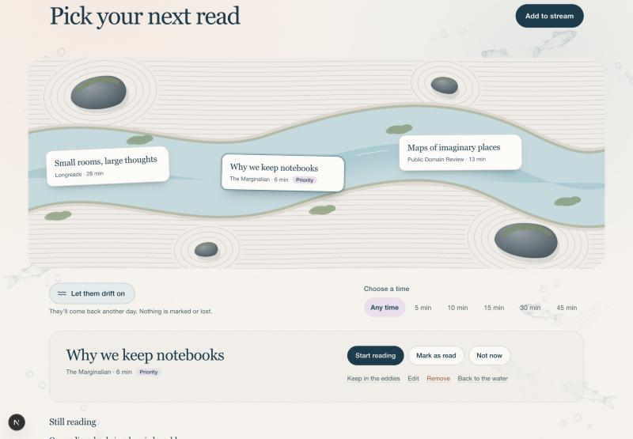

# Reading River: drifting by

A working prototype on `codex/reading-river-eddies`. It is uncommitted and not deployed. Screenshots use synthetic local data from `scripts/seed-drift-demo.ts`.

The fixed "Next priority read" / "From the stream" pair is replaced by a garden river. Three pieces float slowly along a river through raked gravel, stones and moss. You choose one to bring it to the bank, or let them drift on.

## The interaction

- **Three afloat, steady for the day.** Reloads and revisits show the same three. Any that are read, removed, kept in the eddies or opened are replaced one at a time, and the others stay put.
- **Choose one → the bank.** The floating card is a button. Choosing it pauses the drift and opens a panel under the river with every existing action: Start reading, Mark as read, Not now, Keep in the eddies, Renew priority, Edit, Remove. "Back to the water" closes the panel.
- **Let them drift on** sends all three downstream, about 1.3 seconds out, and three new ones come in from upstream over about 2.3 seconds. The current speeds up briefly. The three that left rest for 20 hours. Nothing is marked, deleted or reprioritised.
- **Not now** does the same for a single piece.
- **Choose a time** filters to pieces that fit. Every time budget is drawn on the server ahead of time, so switching between them is instant.

## Reading across two days

Opening a piece's link records it (`fetch` with `keepalive`, so the note survives leaving the page) and lifts it onto the bank. Its status becomes `reading`, an existing status, and it leaves the water. It then sits under **Still reading** until you mark it read or **put it back in the river**, whatever the river shows that day. Coming back with the browser's Back button refreshes the page, so the piece is already on the bank.

If you read something without opening it from here, **Drifted past this week** (a collapsed list) shows the last week's passers, and you can mark one read from there.

## How the rules fit together

The rules live in `lib/reading-river/drift.ts` as one `DRIFT_RULES` object, so the values below can be tuned in one place.

**Weight** = priority factor × recency factor, and it is always above zero.

- Priority factor: 1 + 0.4 × priority, so priority 10 is 5× as likely as none. Priority counts for 14 days from when it was set, renewed or changed in Edit. After that it is 0 (ordinary chance) until you renew it. Pieces without a renewal date count from when they were added.
- Recency factor: 0.25 if the piece was seen today, recovering by 0.15 a day back to 1.

**The draw** is weighted sampling without replacement. Pieces are taken from tiers in order:

1. Fresh pieces.
2. Pieces resting after drifting on.
3. The pieces that just left, only when the collection is too small for anything else.

Snoozed pieces never surface. There are no roles, quotas or variety rules, so three similar pieces can appear together.

**Exposure.** A piece counts as *seen* only after it has stayed afloat for 4 seconds in a visible tab. When you first visit on a later day, that earlier day's selection is settled. Each seen, unopened piece that was still afloat at the end of that day gets one unread appearance, at most once per day across all time budgets. This means:

- reloads add nothing;
- days you never visited add nothing (nothing was drawn or seen);
- drifting on adds nothing, because the pieces that left are removed from that day's selection before it settles.

**Snoozing.** Two unread appearances snooze a piece for 3 days. One more after it returns snoozes it for a week, and so does each further one. Opening a piece, or renewing its priority, clears this history. If everything is snoozed, the river says when the first piece returns and offers **Bring them back now**.

## Small and empty collections

- **One or two pieces:** they sit centrally, "Let them drift on" is disabled, and the hint says "That's everything within reach for now".
- **Everything resting:** says when the first piece returns and offers to bring them all back.
- **No piece fits the chosen time:** offers "Show any length".
- **No pieces at all:** "The water is clear" with Add to stream.

| Small | All resting | Empty |
| --- | --- | --- |
|  |  |  |

## Visual choices

- **A Japanese garden, not a literal pond.** The garden is an inline SVG (`components/reading-river/garden-scene.tsx`) with raked gravel lines, cleared rings around four stones, moss on the stones and banks, and a meandering river with a blurred deeper channel. Faint current lines move along it and a few petals float past.
- **The app's own palette.** Warm paper, deep river ink and the lilac accent are kept, with sage moss and pale teal water added.
- **Restrained motion.** Pieces wander very slowly (36–50 second cycles) and bob a few pixels. They stop whenever the pointer or focus is in the garden, and whenever a piece is on the bank, so you can read and settle.
- **App-wide.** Quieter page light and softer section labels (sentence case, no tracked capitals). The primary button has no shadow and there is more vertical space.
- **Mobile.** The garden turns so the river runs top to bottom. Pieces flow downward and nothing scrolls sideways at 375px.
- **Accessibility.**
  - Floating pieces are real buttons with `aria-pressed`. Choosing one moves focus to the bank, which is labelled with the piece's title.
  - Changes are announced in a live region.
  - Focus rings are visible, and all targets are at least 44px.
  - Text contrast is about 11:1 for ink on paper, and the primary button is the same.
  - With `prefers-reduced-motion`, the current, petals and wandering stop, and drifting on becomes a short fade.

## State added (migration `20261104120000_reading_river_drift`)

On `ReadingItem`:

- `priorityAssignedAt`: backfilled to release time so existing priorities aren't expired at once.
- `lastSurfacedAt`
- `driftMisses`
- `snoozeLevel`
- `snoozedUntil`
- `restingUntil`

New table `DriftState`: one row per user, holding the current selection per time budget (`ids`, `drawnOn`, `seenIds`).

Reused as they were: `status = reading` and `lastOpenedAt`.

## Changed behaviour

- **Skip is gone from the home page.** It set priority to 0, which conflicts with "never remove priority". Not now / Let them drift on replace it. `skipReadingItem` still exists.
- **Eddy articles never float.** The eddies are a curated list already on the same page.
- **Changing priority in Edit renews its 14 days.** Saving the form with the same priority does not.
- **Days use UTC**, as the existing daily picks did.

## Verification

- `tests/lib/reading-river-drift.test.ts`: 11 tests for weights, expiry, the draw, repeat avoidance, small collections and snoozing.
- `tests/integration/reading-river-drift.test.ts`: 6 tests against a local PostgreSQL. They cover:
  - steadiness within a day;
  - an opened piece staying on the bank the next day;
  - recently passed pieces;
  - reloads and unvisited days not counting;
  - drifting on never counting and avoiding repeats;
  - the "nothing else upstream" state.

  Run them with `DRIFT_TEST_DATABASE_URL` pointing at a local database. The suite refuses remote hosts.
- Home page and How It Works tests have been updated. The full suite has 306 passing, plus 5 failing navbar, projects and blog tests that already failed before this work.
- Checked in a browser at 1440px and 375px:
  - lift, drift on, open → Still reading;
  - the small, all-resting and empty states;
  - keyboard: Enter lifts, focus moves to the bank, Tab continues into its actions.
- **Not checked visually:** reduced motion (the browser tool can't emulate it), screen readers, Safari.
